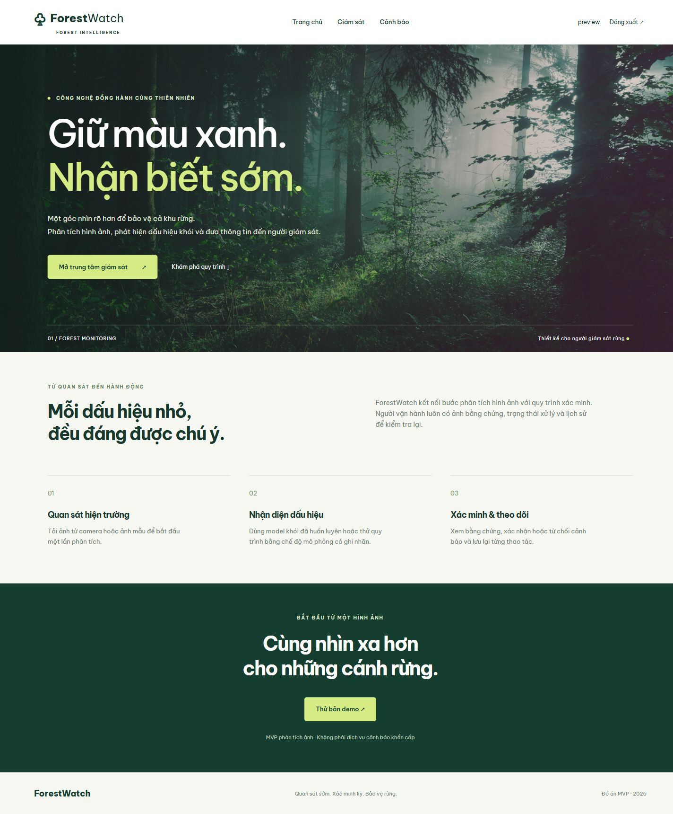

# ForestWatch

Ứng dụng Django giám sát ảnh rừng: đăng nhập, dashboard, tải ảnh, phân đoạn khói bằng FoSp, xem ảnh gốc/mặt nạ và xác minh cảnh báo. Frontend dùng Django templates, CSS và TypeScript; một server Django phục vụ toàn bộ web, chưa có SPA hay API riêng.

MVP xử lý **ảnh tĩnh, đồng bộ từng yêu cầu**. Chưa có camera trực tiếp, video, bản đồ hay thông báo thời gian thực. Demo mô phỏng do người dùng chọn, không chạy AI. Kết quả model cần người xác minh, không phải kết luận hiện trường an toàn hoặc có cháy. Không dùng `runserver` để triển khai công khai.



## Cấu trúc

```text
D:\ForestWatch\
├── backend/                 Django, nghiệp vụ, inference và tests
│   ├── forestwatch/         Settings, URL, WSGI
│   ├── monitor/             Đăng nhập, upload, Analysis/Alert, migration
│   ├── weights/             Chỗ đặt model riêng, không commit
│   └── manage.py
├── frontend/
│   ├── templates/           HTML được Django render
│   ├── src/app.ts           TypeScript nguồn
│   └── static/              CSS, ảnh và JS đã build
├── notebooks/               Notebook/script tiếp tục train FoSp
├── research/                Thử nghiệm nghiên cứu, web chưa dùng
│   ├── temporal_fosp/       FoSp-Temporal: chuẩn bị dữ liệu, train, đánh giá
│   └── day1/                Ghi chú và notebook pilot Day 1 (đã xóa output)
├── scripts/                 Kiểm tra dự án và FoSp web thật
├── docs/                    Kiến trúc, phạm vi sản phẩm, kết quả xác minh
│   ├── README.md            Mục lục tài liệu
│   ├── ARCHITECTURE.md      Luồng xử lý và các thành phần
│   ├── PRODUCT.md           Chức năng, giới hạn và hướng phát triển
│   └── TEMPORAL_RESEARCH.md Nghiên cứu FoSp-Temporal: giao thức và kết quả
├── .github/                 CI, mẫu PR, mẫu báo lỗi
├── .env.example             Mẫu biến môi trường, không chứa secret
├── CONTRIBUTING.md          Quy trình nhánh, PR, review và conflict
└── README.md
```

Trên máy hiện tại, `checkpoints/`, `outputs/`, `work/`, ZIP và log di chuyển là tài nguyên **cục bộ được Git bỏ qua**. Bản repo cũ tại `outputs/forestwatch-mvp` được giữ nguyên; làm việc mới ở gốc `D:\ForestWatch`. Không commit hoặc xóa chúng. Model, thuật toán FoSp, ngưỡng 0,4 và notebook train được giữ nguyên.

## Cài và chạy trên Windows PowerShell

Cần Git, Python 3.12 (hoặc 3.11 cho demo), Node.js 22 nếu sửa frontend. Với máy mới:

```powershell
git clone https://github.com/Nguyenleduy0709/forestwatch-mvp.git D:\ForestWatch
Set-Location D:\ForestWatch
python -m venv .venv
.\.venv\Scripts\python.exe -m pip install -r backend/requirements.txt
```

Trên máy đã có repo ở `D:\ForestWatch`, chỉ `Set-Location` vào đó, **không clone chồng lên dữ liệu**. Có thể dùng môi trường sẵn có `D:\ForestWatch\work\venv\Scripts\python.exe` thay `.\.venv\Scripts\python.exe` trong mọi lệnh bên dưới.

Xem [`.env.example`](.env.example) để biết biến hỗ trợ. Có thể sao chép thành `.env` làm ghi chú riêng, nhưng ứng dụng **không tự nạp `.env`**: đặt biến trong cùng cửa sổ PowerShell trước khi chạy. Không commit `.env` hoặc secret.

```powershell
$env:DJANGO_DEBUG = '1'
$env:DJANGO_ALLOWED_HOSTS = 'localhost,127.0.0.1'
$env:INFERENCE_MODE = 'demo'
.\.venv\Scripts\python.exe backend/manage.py migrate
.\.venv\Scripts\python.exe backend/manage.py createsuperuser
.\.venv\Scripts\python.exe backend/manage.py runserver 127.0.0.1:8000
```

Mở http://127.0.0.1:8000, đăng nhập bằng tài khoản vừa tạo. Không có tài khoản/mật khẩu mặc định. SQLite mặc định tại `backend/db.sqlite3`, ảnh tại `backend/media/`; không đưa vào Git. Nếu muốn dùng database cũ trên máy này, đặt đường dẫn **trước migrate và chạy web**:

```powershell
$env:DATABASE_PATH = 'D:\ForestWatch\outputs\forestwatch-mvp\backend\db.sqlite3'
```

Database cũ lưu đường dẫn ảnh tương đối với media cũ. Để dùng cả tài khoản, lịch sử và bằng chứng cũ, cấu hình thêm:

```powershell
$env:MEDIA_ROOT = 'D:\ForestWatch\outputs\forestwatch-mvp\backend\media'
```

### Chế độ demo

Không cần PyTorch, GPU hay checkpoint. Dùng ảnh `frontend/static/img/forest.jpg`, tick mô phỏng khói rồi upload. Xem ảnh gốc/kết quả, xác nhận cảnh báo, đánh dấu đã xử lý và xem lịch sử. Upload lần nữa không tick mô phỏng để kiểm tra trường hợp không có cảnh báo. Khung demo và nhãn mô phỏng được hiển thị rõ.

### Chế độ FoSp thật trên máy hiện tại

Máy này đã có môi trường CUDA, runtime và checkpoint; không cần sao chép model:

```powershell
Set-Location D:\ForestWatch
$env:INFERENCE_MODE = 'fosp'
$env:FOSP_MODEL_PATH = 'D:\ForestWatch\checkpoints\fosp_smoke5k_14000\best.pth'
$env:FOSP_RUNTIME_DIR = 'D:\ForestWatch\outputs\forestwatch-mvp\.fosp-runtime'
# Thêm DATABASE_PATH và MEDIA_ROOT như trên nếu muốn dùng dữ liệu cũ.
.\work\venv\Scripts\python.exe backend/manage.py migrate
# Chỉ cần tạo tài khoản nếu database đang dùng chưa có tài khoản.
.\work\venv\Scripts\python.exe backend/manage.py runserver 127.0.0.1:8000 --noreload
```

Nếu thiếu tài khoản: chạy `backend/manage.py createsuperuser` bằng cùng Python và cùng biến môi trường. Đổi model cần khởi động lại server. Thiếu model/thư viện hoặc lỗi suy luận sẽ báo lỗi, không tự chuyển sang demo.

### Cài FoSp trên máy mới có GPU NVIDIA

Dùng Python 3.12; cài backend và migrate như trên. Cấu hình dưới đây giữ phiên bản runtime đã dùng cho model hiện tại (PyTorch CUDA 12.8, đã thử trên RTX 5070):

```powershell
git -c core.symlinks=false clone https://github.com/LujianYao/FoSp.git .fosp-runtime/FoSp
git -C .fosp-runtime/FoSp checkout 02b9fd18ad1930d1081cf3b35a569d4b59e71d63
git clone --branch v1.6.2 --depth 1 https://github.com/open-mmlab/mmcv.git .fosp-runtime/mmcv
.\.venv\Scripts\python.exe -m pip install torch==2.7.1 torchvision==0.22.1 --index-url https://download.pytorch.org/whl/cu128
.\.venv\Scripts\python.exe -m pip install -r backend/requirements-fosp.txt
$env:INFERENCE_MODE = 'fosp'
$env:FOSP_MODEL_PATH = 'D:\ForestWatch\backend\weights\fosp_best.pth'
$env:FOSP_RUNTIME_DIR = 'D:\ForestWatch\.fosp-runtime'
.\.venv\Scripts\python.exe backend/manage.py runserver 127.0.0.1:8000 --noreload
```

Đặt checkpoint `best.pth` đáng tin cậy vào đường dẫn `FOSP_MODEL_PATH`, hoặc trỏ biến đến vị trí có sẵn. Không tải checkpoint vào Git. Runtime phải chứa cả `FoSp/` và `mmcv/`. Web FoSp hiện yêu cầu CUDA, chưa có đường chạy CPU. [Số liệu checkpoint 14.000](docs/fosp_smoke5k_14000.json): F1 trung bình theo ảnh 76,88%, IoU 68,24% trên 400 ảnh test SMOKE5K; không suy rộng thành độ chính xác mọi hiện trường.

Giữ nguyên `last.pth`, `best.pth`, `manifest.json`, `run_config.json`, kết quả và mã train cùng đợt trong ổ D để tiếp tục train. `last.pth` chứa optimizer/trạng thái train; không thay bằng `best.pth` khi resume. Xem [hướng dẫn notebook](notebooks/README.md) và [notebook tiếp tục FoSp](notebooks/fosp_continue.ipynb). Không thay tập chia dữ liệu hoặc lịch train khi chỉ tái cấu trúc web.

Chế độ YOLO đã có vẫn được giữ: cài `backend/requirements-ai.txt`, đặt `INFERENCE_MODE=yolo`, `MODEL_PATH` là đường dẫn tuyệt đối đến model detection đã train smoke/fire, `MODEL_CONFIDENCE=0.35`. Đây là tùy chọn riêng, không thay FoSp.

## Sửa frontend

```powershell
npm.cmd --prefix frontend ci
npm.cmd --prefix frontend run check
npm.cmd --prefix frontend run build
```

Commit cả TypeScript và JS đã build. JS có sẵn trong repo nên chạy demo không cần Node. CSS/templates sửa trực tiếp rồi tải lại Django; không có `npm start` hay server frontend riêng. Font ngoài mạng là tùy chọn, có font hệ thống dự phòng.

## Kiểm tra

Chạy toàn bộ backend + frontend, không cần GPU hoặc model:

```powershell
.\scripts\check.ps1
# Môi trường hiện có trên máy này:
.\scripts\check.ps1 -Python .\work\venv\Scripts\python.exe
```

Nếu PowerShell chặn script, có thể chạy các lệnh tương đương:

```powershell
$env:INFERENCE_MODE = 'demo'
.\.venv\Scripts\python.exe backend/manage.py check
.\.venv\Scripts\python.exe backend/manage.py makemigrations --check --dry-run
Push-Location backend
..\.venv\Scripts\python.exe manage.py test monitor --noinput
Pop-Location
.\.venv\Scripts\python.exe scripts/check_demo_web.py
npm.cmd --prefix frontend ci
npm.cmd --prefix frontend run check
npm.cmd --prefix frontend run build
git diff --exit-code -- frontend/static/js/app.js
.\.venv\Scripts\python.exe backend/manage.py collectstatic --noinput
```

Test kiểm tra đăng nhập, dashboard, upload, cảnh báo/lịch sử, phân quyền bằng chứng, CSRF, ảnh lỗi và dispatch FoSp/YOLO. Các test adapter dùng kết quả giả lập, không đánh giá độ chính xác AI. `scripts/check_demo_web.py` kiểm tra luồng demo qua server HTTP thật với database/media tạm. CI chạy backend trên Windows/Linux và frontend trên Linux, chỉ cài `backend/requirements.txt` và TypeScript.

Kiểm tra web FoSp thật (ngoài CI), sau khi đặt `FOSP_MODEL_PATH` và `FOSP_RUNTIME_DIR`:

```powershell
.\work\venv\Scripts\python.exe scripts/check_fosp_web.py --image <duong-dan-anh-khoi-goc>
```

Nên chọn ảnh khói gốc, không phải ảnh đã tô màu. Script dùng SQLite trong RAM và media tạm dưới `work/`, không ghi vào database/ảnh người dùng; kiểm tra upload, ảnh mặt nạ, trang kết quả và cảnh báo nếu có khói. Xem [biên bản tái cấu trúc](docs/RESTRUCTURING.md) để biết kiểm tra thực tế và giới hạn.

## Làm việc nhóm và tài liệu

Dùng `main` ổn định, nhánh `feature/<ten-chuc-nang>` hoặc `fix/<ten-loi>`, PR và review theo [CONTRIBUTING.md](CONTRIBUTING.md). Không tạo `develop` khi chưa có nhu cầu phát hành riêng. Bảo vệ main là đề xuất chờ quản trị viên xác nhận.

- [Mục lục tài liệu](docs/README.md), [kiến trúc](docs/ARCHITECTURE.md), [phạm vi sản phẩm](docs/PRODUCT.md).
- [Backend và các route](backend/README.md), [Frontend](frontend/README.md).
- [Kết quả xác minh trước đây](docs/VALIDATION.md), [tài nguyên và giấy phép](docs/ASSETS.md).
- Code MIT: [LICENSE](LICENSE). Model, dữ liệu, ảnh và thư viện ngoài giữ giấy phép riêng.
