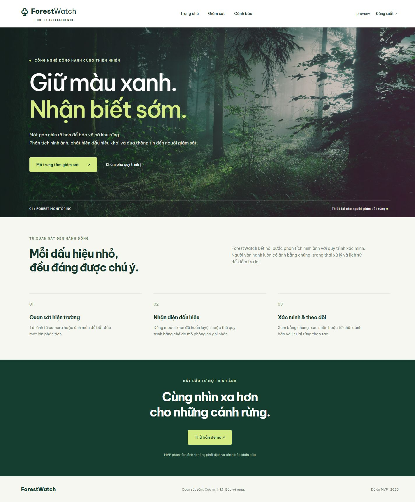

# ForestWatch

**ForestWatch** là hệ thống giám sát rừng và phát hiện khói cháy rừng sớm theo thời gian thực dùng **Django**, **PyTorch / FoSp (FoSp-Gate E6)** và **TypeScript/JavaScript**. Hỗ trợ phòng giám sát đa màn hình CCTV (ảnh, video, luồng HTTP/YouTube, RTSP, HLS), khoanh vùng loại trừ báo động giả (ROI), gom sự kiện theo chuỗi khung hình và gửi cảnh báo tức thì kèm ảnh bằng chứng qua **Telegram** và **Email SMTP**.



---

## 1. Triển khai nhanh bằng Docker trên máy mới (Khuyên dùng)

Chỉ cần máy đích đã cài **Git** và **Docker Desktop** (không cần cài Python, PyTorch, OpenCV, FFmpeg hay Node.js thủ công — toàn bộ thư viện và runtime `.fosp-runtime` đã được đóng gói sẵn trong image).

### Bước 1: Clone mã nguồn từ GitHub

```bash
git clone https://github.com/Nguyenleduy0709/forestwatch-mvp.git
cd forestwatch-mvp
```

### Bước 2 (Tùy chọn): Cấu hình `.env`

Nếu muốn dùng thông báo Telegram, gửi Email SMTP hoặc đăng nhập Google OAuth:

```bash
# Linux / macOS / Git Bash:
cp .env.example .env

# Windows PowerShell:
Copy-Item .env.example .env
```

Sau đó mở `.env` điền các biến cần thiết (`TELEGRAM_BOT_TOKEN`, `TELEGRAM_BOT_USERNAME`, `EMAIL_HOST*`, `GOOGLE_CLIENT_*`, `PUBLIC_BASE_URL`).  
*(Nếu chưa tạo `.env`, Docker Compose vẫn khởi động bình thường vì `env_file` đặt `required: false`.)*

### Bước 3 (Để chạy AI FoSp thật): Đặt checkpoint `best.pth`

Do tệp model nặng (~442 MB) không lưu trực tiếp trên GitHub, hãy chép tệp `best.pth` vào một trong hai vị trí:
- `backend/weights/best.pth` *(khuyên dùng — thư mục này được mount trực tiếp vào container)*, **hoặc**
- `./best.pth` tại thư mục gốc dự án.

> **Lưu ý:** Nếu trên máy mới bạn chưa chép `best.pth`, container vẫn **tự khởi động bình thường ở chế độ `INFERENCE_MODE=demo`** (không bị crash). Sau khi chép `best.pth` vào `backend/weights/best.pth`, chỉ cần chạy `docker compose restart web` là AI thật tự kích hoạt.

### Bước 4: Khởi động hệ thống bằng Docker

**Lần đầu trên máy mới (build image và chạy nền):**

```bash
docker compose up -d --build
```

**Các lần sau (mở Docker Desktop là container tự bật nhờ `restart: unless-stopped`, hoặc chạy):**

```bash
docker compose up -d
```

Hoặc chạy độc lập trực tiếp từ image đã build (khi muốn nhấn **Run** từ Docker Desktop hoặc CLI):

```bash
docker run -d -p 8000:8000 --name forestwatch-web forestwatch-web:latest
```

Mở trình duyệt truy cập: **`http://localhost:8000/`** (hoặc **`http://127.0.0.1:8000/`**).

### Bước 5: Tạo tài khoản trên máy mới (khi DB mới tinh)

- Đăng ký nhanh tài khoản người dùng tại `/register/`, hoặc tạo tài khoản quản trị (`admin` / `/admin/`) bằng lệnh:

```bash
docker compose exec web python backend/manage.py createsuperuser
```

### Lệnh quản lý Docker thường dùng

```bash
docker compose ps                  # Kiểm tra trạng thái container (healthy)
docker compose logs -f web         # Xem log server thời gian thực
docker compose restart web         # Khởi động lại sau khi sửa .env hoặc thêm best.pth
docker compose stop                # Tạm dừng container
docker compose down                # Dừng và gỡ container (giữ nguyên DB & media trên máy)
```

> **Lưu ý xung đột cổng `8000`:** Nếu máy bạn có container của dự án khác đang chiếm cổng `8000`, hãy dừng container đó (`docker stop <tên_container>`) trước khi chạy ForestWatch.

---

## 2. Cấu trúc thư mục

```text
forestwatch-mvp/
├── backend/
│   ├── forestwatch/           Cấu hình Django (settings.py, urls.py, wsgi.py)
│   ├── monitor/               Ứng dụng chính: auth, inference, live_cameras,
│   │                          smoke_events, notifications, telegram_bot, views
│   ├── db/                    Thư mục lưu SQLite (backend/db/db.sqlite3, mount Docker)
│   ├── media/                 Ảnh chụp bằng chứng & 4 video demo mẫu (demo_streams/)
│   ├── weights/               Đặt checkpoint best.pth khi triển khai
│   ├── requirements*.txt      Danh sách thư viện Python (Django, FoSp, yt-dlp)
│   └── manage.py
├── frontend/
│   ├── templates/             Giao diện HTML Django (home, control_room, alerts, dashboard, settings...)
│   ├── src/                   Mã nguồn TypeScript frontend
│   └── static/                CSS, ảnh và JS đã build
├── scripts/                   Script kiểm tra hệ thống (check.ps1, check_demo_web.py...)
├── research/ & notebooks/     Mã nghiên cứu và huấn luyện FoSp-Temporal
├── docs/                      Tài liệu kiến trúc & kết quả kiểm thử trong repo
├── Dockerfile                 Đóng gói Python 3.12 + PyTorch CPU + FFmpeg + Node.js + FoSp runtime
├── docker-compose.yml         Chạy dịch vụ web (port 8000, volume db/media/weights)
├── docker-entrypoint.sh       Tự migrate, kiểm tra model/fallback demo và bật server
└── .env.example               Mẫu biến môi trường
```

---

## 3. Chạy trực tiếp trên Windows PowerShell (Không qua Docker)

Yêu cầu: Python 3.12, Git, (tùy chọn Node.js cho `yt-dlp` và `npm` build TS).

### Chế độ Demo nhanh (không cần PyTorch / model)

```powershell
python -m venv .venv
.\.venv\Scripts\python.exe -m pip install -r backend/requirements.txt
$env:DJANGO_DEBUG = '1'
$env:INFERENCE_MODE = 'demo'
.\.venv\Scripts\python.exe backend/manage.py migrate
.\.venv\Scripts\python.exe backend/manage.py createsuperuser
.\.venv\Scripts\python.exe backend/manage.py runserver 127.0.0.1:8000 --noreload
```

### Chế độ AI FoSp thật

```powershell
git -c core.symlinks=false clone https://github.com/LujianYao/FoSp.git .fosp-runtime/FoSp
git -C .fosp-runtime/FoSp checkout 02b9fd18ad1930d1081cf3b35a569d4b59e71d63
git clone --branch v1.6.2 --depth 1 https://github.com/open-mmlab/mmcv.git .fosp-runtime/mmcv
.\.venv\Scripts\python.exe -m pip install torch torchvision --index-url https://download.pytorch.org/whl/cpu
.\.venv\Scripts\python.exe -m pip install -r backend/requirements-fosp.txt -r backend/requirements-video.txt
```

Cấu hình trong `.env` (hoặc PowerShell):
```dotenv
INFERENCE_MODE=fosp
FOSP_MODEL_PATH=./best.pth
FOSP_RUNTIME_DIR=./.fosp-runtime
```
Sau đó chạy:
```powershell
.\.venv\Scripts\python.exe backend/manage.py migrate
.\.venv\Scripts\python.exe backend/manage.py runserver 0.0.0.0:8000 --noreload
```

---

## 4. Tính năng chính & Kênh cảnh báo

- **Phòng giám sát (`/control-room/`):** Hỗ trợ nhiều ô camera/video cùng lúc (video từ máy, link YouTube/MP4, 4 luồng demo có sẵn, RTSP/HLS), vẽ **vùng loại trừ ROI** trực tiếp trên khung hình để bỏ qua mây/chói nắng/mái tôn.
- **Bộ lọc chống báo động giả:** Ngưỡng tin cậy (`min_confidence`), diện tích vùng khói (`min_smoke_coverage`), xác nhận đa khung hình liên tiếp (`persistence_frames`), gom chuỗi sự kiện khói (`SmokeEvent` + ảnh đỉnh `peak_annotated`).
- **Thông báo ngoài ứng dụng (`/settings/`):**
  - **Telegram Bot 1 chạm (`@forestwatch51_bot`):** Sinh lệnh `/start fw_...` để kết nối cá nhân (Telegram Web / Mobile / Desktop) hoặc thêm vào nhóm trực ban mà không cần người dùng tự tìm `chat_id` qua API.
  - **Email SMTP:** Gửi thư HTML đính kèm ảnh hiện trường và liên kết xác minh (`PUBLIC_BASE_URL`).
- **Quản lý cảnh báo (`/alerts/`, `/runs/<uuid>/`):** Xác minh (`PENDING` → `CONFIRMED` / `REJECTED` / `RESOLVED`), lưu nhật ký `AlertHistory`, xuất báo cáo CSV UTF-8 BOM.

---

## 5. Kiểm thử hệ thống

```powershell
.\.venv\Scripts\python.exe backend/manage.py check
.\.venv\Scripts\python.exe backend/manage.py makemigrations --check --dry-run
.\.venv\Scripts\python.exe backend/manage.py test monitor --noinput
```

Hoặc chạy script tổng hợp:
```powershell
.\scripts\check.ps1
```

Build lại frontend nếu chỉnh sửa TypeScript (`frontend/src/`):
```powershell
npm.cmd --prefix frontend ci
npm.cmd --prefix frontend run check
npm.cmd --prefix frontend run build
```

---

## 6. Tài liệu chi tiết trong repo

- [Mục lục tài liệu](docs/README.md) · [Kiến trúc hệ thống](docs/ARCHITECTURE.md) · [Phạm vi sản phẩm](docs/PRODUCT.md)
- [Backend & Routes](backend/README.md) · [Frontend](frontend/README.md) · [Quy trình Git/PR](CONTRIBUTING.md)
- Giấy phép mã nguồn: [LICENSE](LICENSE).
