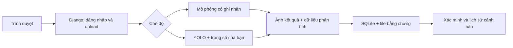

# ForestWatch 🌲

**MVP web giám sát rừng và xác minh cảnh báo khói**, xây bằng Django, HTML/CSS và TypeScript. Giao diện xanh rừng, ảnh toàn cảnh, tối ưu cho buổi demo nhóm.


## Chạy được những gì?

- Đăng nhập bằng tài khoản Django; dữ liệu mỗi người được tách biệt.
- Tải ảnh JPG/PNG/WebP, kiểm tra định dạng/kích thước, bỏ metadata và chuẩn hóa ảnh.
- Chế độ **demo**: người dùng chủ động chọn tình huống có/không có phát hiện. **Không chạy AI**, không tạo điểm tin cậy giả.
- Chế độ **yolo**: chạy model detection đã fine-tune có nhãn smoke/fire và vẽ khung thật.
- Một lần phân tích có đối tượng tạo một cảnh báo kèm ảnh bằng chứng.
- Xác nhận/từ chối, đóng sự kiện đã xác nhận; lưu người thực hiện, thời gian và ghi chú.
- Lịch sử và bộ lọc trạng thái; xem lại ảnh gốc/kết quả.
- Ảnh bằng chứng chỉ truy cập được sau đăng nhập và kiểm tra chủ sở hữu.

**Phạm vi:** MVP phân tích ảnh tĩnh, chạy trên máy để trình diễn. Chưa có camera trực tiếp, video, bản đồ, cảnh báo theo chuỗi thời gian, chống trùng giữa nhiều lần tải ảnh, FoSp, SAM hay dự báo nguy cơ theo thời tiết. Không tự gửi thông báo ra bên ngoài.

## 1. Khởi động nhanh — không cần GPU

Cần Python 3.11 hoặc 3.12 và kết nối mạng ở lần cài thư viện đầu tiên.

### Windows PowerShell

```powershell
python -m venv .venv
.\.venv\Scripts\python.exe -m pip install -r requirements.txt
.\.venv\Scripts\python.exe manage.py migrate
.\.venv\Scripts\python.exe manage.py createsuperuser
.\.venv\Scripts\python.exe manage.py runserver
```

### macOS / Linux

```bash
python3 -m venv .venv
.venv/bin/python -m pip install -r requirements.txt
.venv/bin/python manage.py migrate
.venv/bin/python manage.py createsuperuser
.venv/bin/python manage.py runserver
```

Mở **http://127.0.0.1:8000**, đăng nhập bằng tài khoản vừa tạo. Không có mật khẩu mặc định. TypeScript đã được biên dịch và lưu sẵn trong `static/js/app.js`; **không cần Node.js để chạy demo**.

Mặc định `INFERENCE_MODE=demo`. Không cần tải dataset hay model để thử quy trình web. Ảnh rừng đã có tại `static/img/forest.jpg`, có thể chọn ảnh này cho buổi demo.

## 2. Kịch bản trình diễn 3 phút

1. Giới thiệu trang chủ, chọn **Mở trung tâm giám sát**, đăng nhập.
2. Chọn ảnh rừng, tích **Mô phỏng phát hiện khói**, bấm chạy.
3. Chỉ rõ banner mô phỏng: vùng khung là dựng sẵn, không phải AI nhận diện.
4. Chuyển qua ảnh gốc/kết quả, nhập ghi chú và **Xác nhận**.
5. Bấm **Đánh dấu đã xử lý**, xem lịch sử thay đổi.
6. Tải ảnh lần nữa, bỏ tích ô mô phỏng: lần này không sinh cảnh báo.
7. Mở trang **Cảnh báo**, lọc trạng thái và xem lại bằng chứng.

Nếu có trọng số hợp lệ, dùng hướng dẫn dưới để trình diễn kết quả AI thật.

## 3. Bật YOLO thật

Cài thêm thư viện và đặt file trọng số **đã huấn luyện nhận diện khói** tại `weights/best.pt`. File này không được kèm ZIP/repo. Không dùng `yolo11n.pt`/COCO mặc định rồi coi đó là model khói. MVP hỗ trợ model object detection có nhãn `smoke`, `fire`, `khói`, `lửa`, `khoi`, `lua`.

```powershell
.\.venv\Scripts\python.exe -m pip install -r requirements-ai.txt
$env:INFERENCE_MODE = 'yolo'
$env:MODEL_PATH = (Resolve-Path '.\weights\best.pt').Path
$env:MODEL_CONFIDENCE = '0.35'
.\.venv\Scripts\python.exe manage.py runserver --noreload
```

macOS/Linux: `INFERENCE_MODE=yolo MODEL_PATH="$PWD/weights/best.pt" .venv/bin/python manage.py runserver --noreload`.

- Khởi động lại khi thay trọng số; model được giữ trong bộ nhớ sau lần tải đầu.
- Nếu thiếu model/thư viện hoặc lỗi suy luận, web báo lỗi; **không tự chuyển sang mô phỏng**.
- Ngưỡng 0.35 chỉ là điểm khởi đầu để thử, cần chọn theo validation thực tế.
- Điểm model không đồng nghĩa xác suất cháy. Không phát hiện không đồng nghĩa an toàn.
- Pyro-SDIS có một lớp khói. Web hỗ trợ nhãn lửa nếu model có lớp lửa; nó không tự tạo năng lực nhận diện lửa cho model chỉ học khói.
- Chỉ nạp `.pt` từ nguồn bạn tin cậy. Kiểm tra license của Ultralytics và trọng số trước khi phân phối/sử dụng thương mại.

Huấn luyện trên Kaggle là bước riêng: kiểm tra nhãn, tách theo camera/chuỗi khi có thể, giữ test độc lập, đánh giá precision/recall/mAP và báo nhầm trên mây/sương. Không dùng các khung gần giống nhau ở cả train và test. Repo này chưa kèm notebook training hay trọng số, chưa có số liệu chất lượng AI thực nghiệm.

## 4. Sửa giao diện

```bash
npm ci
npm run check
npm run build
```

- HTML: `templates/`
- CSS: `static/css/app.css`
- TypeScript: `frontend/app.ts`
- JavaScript được tạo: `static/js/app.js`
- Ảnh đầu trang: `static/img/forest.jpg`

Google Fonts là tùy chọn: không có mạng thì dùng font hệ thống. Ảnh rừng được lưu sẵn nên demo không phụ thuộc tải ảnh từ Internet.

## 5. Kiểm tra

```powershell
.\.venv\Scripts\python.exe manage.py check
.\.venv\Scripts\python.exe manage.py test
```

Test bao gồm: luồng mô phỏng có/không có cảnh báo, lịch sử trạng thái, chống cập nhật sai trạng thái, quyền sở hữu ảnh/cảnh báo, yêu cầu đăng nhập, CSRF, ảnh không hợp lệ, thiếu model không fallback và adapter YOLO với kết quả giả lập. Test adapter không chứng minh model thật chính xác.

## Cấu trúc

```text
forestwatch/           Cấu hình Django, URL và WSGI
monitor/              Models, xử lý upload, adapter AI, views và test
monitor/migrations/   Migration tạo database
templates/            Trang chủ, đăng nhập, dashboard, kết quả, cảnh báo
frontend/             Mã TypeScript
static/               CSS, JS đã build, ảnh nền
weights/              Đặt best.pt của bạn vào đây (không commit)
docs/                 Ảnh giao diện và ghi chú kiểm tra
```

Database SQLite và ảnh trong `media/` được tạo khi chạy, không đưa vào Git. Đường dẫn `.env.example` chỉ là tài liệu mẫu; ứng dụng đọc biến môi trường của shell, **không tự tải file .env**.

## Kiến trúc MVP



MVP suy luận đồng bộ một ảnh mỗi yêu cầu để dễ chạy tối nay. Khi thêm video hoặc nhiều người dùng, tách suy luận sang worker có hàng đợi, giới hạn dung lượng và tần suất, xử lý timeout; không chạy vòng lặp video trong request Django. Không dùng `runserver` cho môi trường công khai. Trước triển khai cần thiết lập secret riêng, DEBUG=0, HTTPS, static/media storage và cấu hình vận hành phù hợp.

## Lộ trình sau buổi demo

1. Gắn và đánh giá model khói thật, chọn ngưỡng validation.
2. Worker đọc video, lấy mẫu khung hình; xét nhiều lần quan sát và chống cảnh báo trùng.
3. Quản lý camera, bản đồ vị trí camera, dashboard thống kê.
4. Thử 50 nhãn giả SAM và kiểm tra thủ công trước khi cân nhắc FoSp.

## Tài nguyên và ghi công

- Django: https://www.djangoproject.com/
- Ultralytics: https://docs.ultralytics.com/
- Pyro-SDIS: https://huggingface.co/datasets/pyronear/pyro-sdis
- Ảnh rừng: Unsplash, ảnh `photo-1448375240586-882707db888b`; xem `docs/ASSETS.md`. Ảnh và font giữ license của tác giả, không thuộc license code.

Code dự án được cấp phép MIT, xem `LICENSE`.
