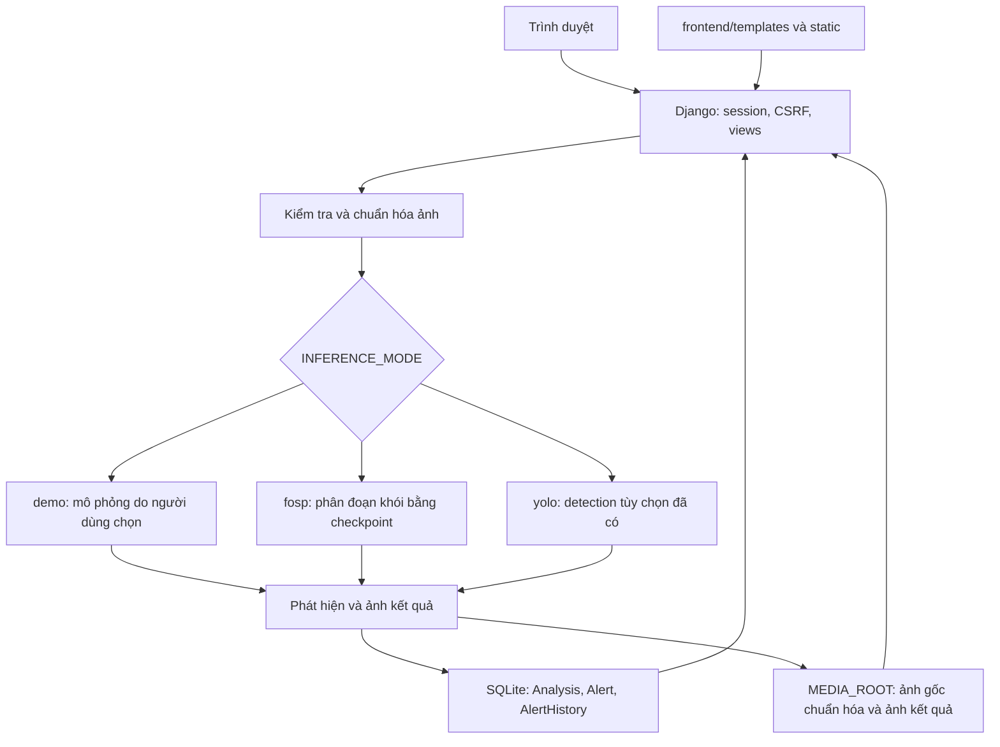
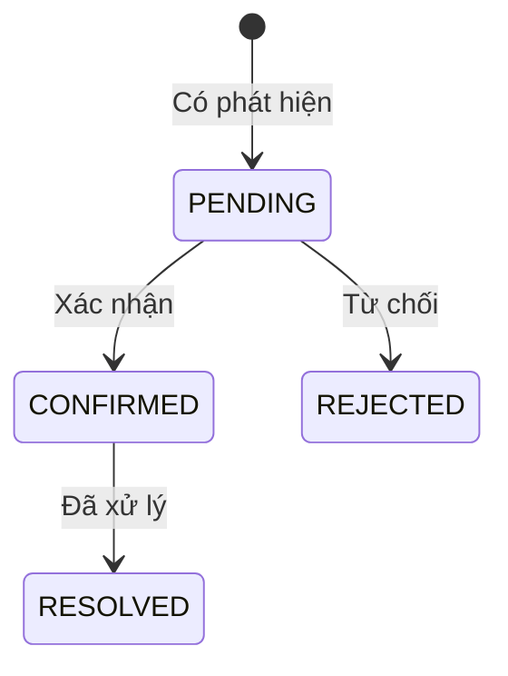

# Kiến trúc ForestWatch

Mô tả theo mã nguồn ngày 04/11/2026. Bắt đầu tại [README](../README.md) để cài và chạy; xem [phạm vi sản phẩm](PRODUCT.md) và [kết quả xác minh](RESTRUCTURING.md). Tài liệu mô tả ứng dụng hiện có, không phải cam kết các tính năng tương lai đã được triển khai.

## 1. Thành phần và cách chạy

ForestWatch là một ứng dụng Django dùng SQLite và lưu file ảnh trên đĩa. Backend render HTML trong `frontend/templates/`; CSS, JavaScript và ảnh giao diện ở `frontend/static/`. TypeScript được build thành `frontend/static/js/app.js` và commit cùng mã nguồn. Không có server frontend riêng hay REST API cho SPA.

| Thành phần | Điểm vào mã nguồn | Trách nhiệm |
| --- | --- | --- |
| Cấu hình / route | `backend/forestwatch/settings.py`, `urls.py` | Đường dẫn, session, middleware, chế độ inference |
| Upload | `backend/monitor/forms.py` | Giới hạn dung lượng/định dạng và chuẩn hóa ảnh |
| Nghiệp vụ | `backend/monitor/views.py` | Trang web, phân quyền, lưu phân tích và xử lý cảnh báo |
| Chọn chế độ | `backend/monitor/inference.py` | Demo, FoSp hoặc YOLO; không tự fallback |
| FoSp | `backend/monitor/fosp.py` | Nạp model, suy luận mặt nạ và tô màu |
| Dữ liệu | `backend/monitor/models.py`, `migrations/` | Analysis, Alert, AlertHistory và schema |
| Giao diện | `frontend/templates/`, `static/`, `src/app.ts` | Hiển thị, preview ảnh, chuyển ảnh gốc/kết quả |
| Kiểm tra | `backend/monitor/tests.py`, `scripts/` | Nghiệp vụ, HTTP demo và tích hợp FoSp thật |
| Huấn luyện | `notebooks/` | Quy trình train/resume riêng, không chạy trong request web |

## 2. Luồng phân tích ảnh

1. Người dùng đăng nhập qua Django session; `/dashboard/` hiển thị dữ liệu thuộc người đó.
2. Gửi multipart đến `POST /analyze/`, gồm `image`, `source` và tùy chọn `simulate_smoke` cho demo. POST yêu cầu CSRF.
3. Form nhận JPEG/PNG/WebP tối đa 10 MB và 24 triệu pixel, xoay theo EXIF, chuyển RGB và thu nhỏ trong khung 1920 × 1920. Ảnh lưu làm bằng chứng gốc là bản đã chuẩn hóa, không phải file byte-for-byte ban đầu.
4. `predict()` chọn đúng `INFERENCE_MODE`. Demo dựng khung khi người dùng chọn mô phỏng; FoSp trả mặt nạ; YOLO tùy chọn trả khung detection từ model đã train.
5. Lưu ảnh chuẩn hóa và kết quả dưới dạng JPEG, tạo `Analysis`; tạo đúng một `Alert` nếu danh sách phát hiện không rỗng. Trang kết quả hiển thị ảnh, chế độ và thông số.
6. Người dùng xác nhận/từ chối cảnh báo, hoặc đóng cảnh báo đã xác nhận. Mỗi cập nhật thành công có bản ghi lịch sử.

Lỗi ảnh hoặc inference được báo về dashboard và không tạo Analysis/Alert cho kết quả thất bại. Không tự đổi FoSp/YOLO lỗi thành demo.

## 3. Model FoSp và ranh giới với training

FoSp hiện giữ nguyên kiến trúc MiT-B3, runtime và preprocessing từ quy trình train: resize 512 × 512, chuẩn hóa RGB, suy luận logits, nội suy về kích thước ảnh chuẩn hóa và ngưỡng sigmoid **> 0,4**. Vùng khói được tô màu cam. `mask_coverage` là phần trăm pixel mặt nạ, không phải điểm tin cậy hoặc xác suất cháy.

`FOSP_MODEL_PATH` trỏ tới checkpoint; `FOSP_RUNTIME_DIR` chứa `FoSp/` và `mmcv/`. Loader nạp `state_dict` strict, cần NVIDIA CUDA, cache model trong process và dùng lock cho suy luận. Đổi checkpoint hoặc cấu hình cần khởi động lại server. Chế độ demo không cần import PyTorch/GPU.

Checkpoint, dataset và runtime là tài nguyên cục bộ được Git bỏ qua. `best.pth` dùng suy luận; để resume train phải giữ đúng `last.pth`, manifest, cấu hình, trạng thái và mã train cùng đợt. Không thay model, ngưỡng hoặc tập chia dữ liệu như một phần của việc sắp xếp repository. Chi tiết tại [notebooks](../notebooks/README.md).

## 4. Dữ liệu và cảnh báo

| Bản ghi | Nội dung và quan hệ |
| --- | --- |
| `Analysis` | UUID, chủ sở hữu, nguồn ảnh, đường dẫn ảnh gốc/kết quả, chế độ, detections JSON, thời gian xử lý/tạo |
| `Alert` | Quan hệ một-một với Analysis, trạng thái và thời điểm cập nhật |
| `AlertHistory` | Thuộc Alert, người thao tác, trạng thái trước/sau, ghi chú tối đa 500 ký tự và thời điểm |

Chỉ chấp nhận các chuyển trạng thái trên. Cập nhật có điều kiện theo trạng thái cũ để phát hiện thao tác đồng thời; ghi thay đổi và lịch sử trong transaction. File ảnh được lưu trước transaction database; hiện chưa có tác vụ tự dọn file mồ côi hoặc chính sách lưu trữ dài hạn.

## 5. Quyền truy cập và đường dẫn

Các route nghiệp vụ yêu cầu đăng nhập. Truy vấn Analysis/Alert lọc theo chủ sở hữu, kể cả xem ảnh và đổi trạng thái. Ảnh bằng chứng được phục vụ qua view có kiểm tra quyền với `Cache-Control: private, no-store`, không có public media route. Django admin dành cho tài khoản có quyền riêng.

| Biến | Mặc định / ý nghĩa |
| --- | --- |
| `DATABASE_PATH` | `backend/db.sqlite3`; dùng đường dẫn tuyệt đối khi chọn database khác |
| `MEDIA_ROOT` | `backend/media`; phải trỏ đúng kho ảnh tương ứng với database |
| `INFERENCE_MODE` | `demo`; hỗ trợ `demo`, `fosp`, `yolo` |
| `FOSP_MODEL_PATH` | `backend/weights/fosp_best.pth` |
| `FOSP_RUNTIME_DIR` | `.fosp-runtime/` ở gốc repository |
| `MODEL_PATH`, `MODEL_CONFIDENCE` | Trọng số và ngưỡng cho tùy chọn YOLO |

Settings lấy đường dẫn frontend/static mặc định từ vị trí mã nguồn. Biến môi trường được đọc từ shell; `.env.example` chỉ là mẫu, không tự nạp `.env`. Dùng đường dẫn tuyệt đối cho mọi override file/thư mục để tránh phụ thuộc thư mục shell. Không commit secret, SQLite, media, model hoặc dữ liệu train.

## 6. Kiểm tra và giới hạn vận hành

- Test backend kiểm tra nghiệp vụ/phân quyền và adapter dùng kết quả giả lập. HTTP demo kiểm tra server thật với database/media tạm.
- CI chạy backend trên Windows/Linux, frontend trên Linux; không cần checkpoint/GPU. Kiểm tra FoSp thật là script riêng ngoài CI. Các lệnh tại [README](../README.md#kiểm-tra).
- Chưa có worker/hàng đợi, giới hạn tần suất, video/stream, bản đồ hoặc thông báo ngoài ứng dụng. Lock và cache FoSp chỉ có hiệu lực trong từng process, không điều phối nhiều server.
- `runserver` dành cho phát triển local. Chưa bổ sung Docker/deploy trong phạm vi hiện tại. Khi có nhu cầu triển khai, cần thiết kế vận hành, HTTPS, secret, backup và storage phù hợp trước khi mở dịch vụ.
