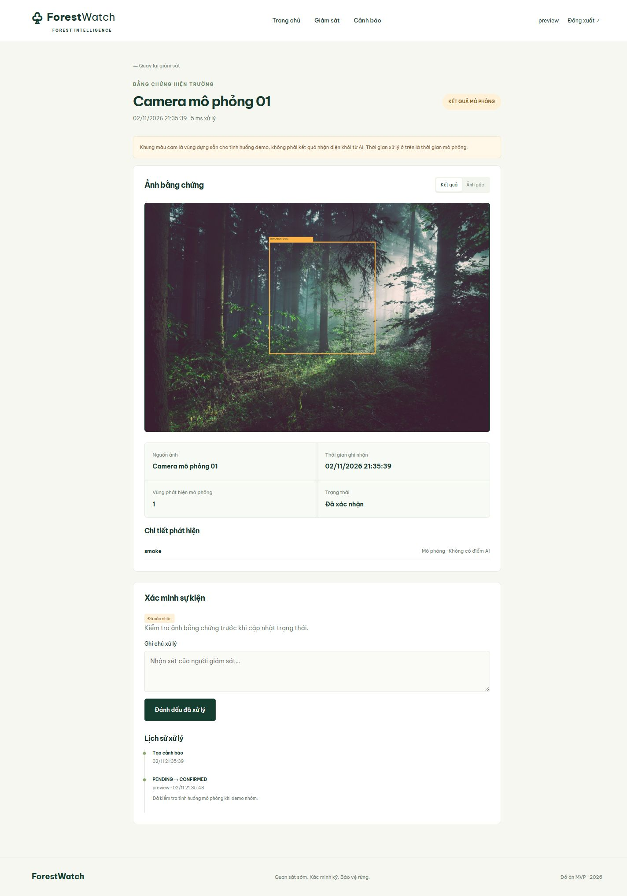
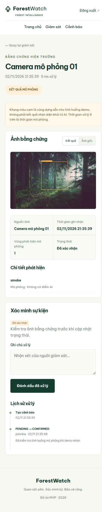

# Kiểm tra bản MVP

Sau khi tách backend/frontend và đổi bố cục dọc, đã chạy trên Python 3.12, Django 5.2 và TypeScript 5.9:

- Từ `backend/`: `python manage.py check`: không có lỗi.
- Từ `backend/`: `python manage.py makemigrations --check --dry-run`: migration khớp models.
- Từ `backend/`: `python manage.py test monitor`: 9 tests đạt.
- Từ gốc repo: `npm --prefix frontend run check` và `npm --prefix frontend run build`: biên dịch thành công.
- Trình duyệt: trang chủ, đăng nhập, tải ảnh, preview ảnh, tạo cảnh báo mô phỏng, xác nhận và xuất hiện lịch sử; quan sát giao diện hẹp và desktop.

Ảnh chụp dashboard dùng tài khoản `preview` và sự kiện mô phỏng phục vụ kiểm tra; tài khoản, mật khẩu và database này không nằm trong ZIP/Git. Tạo tài khoản riêng theo README.

Đã kiểm tra suy luận FoSp thật trên RTX 5070 Laptop với PyTorch 2.7.1 CUDA 12.8. Một ảnh khói SmokeSeg được tải qua route `/analyze/`, tạo mặt nạ tô màu, bản ghi FoSp và cảnh báo. Trang chi tiết và ảnh bằng chứng trả về thành công. Benchmark SMOKE5K được ghi riêng trong README và tệp kết quả trên Kaggle.

## Kiểm tra bố cục mới

- Server Django phục vụ templates và assets sau khi di chuyển thư mục.
- Dashboard và trang kết quả hiển thị bố cục dọc; kiểm tra trang kết quả tại desktop 1440 px và mobile 390 px, không tràn ngang ở 390 px.
- Ảnh bằng chứng và thông số hiển thị; chuyển ảnh gốc/kết quả hoạt động.
- Recipe YOLO cũ vẫn là hướng dẫn riêng. FoSp dùng checkpoint SMOKE5K và chế độ `INFERENCE_MODE=fosp`.

