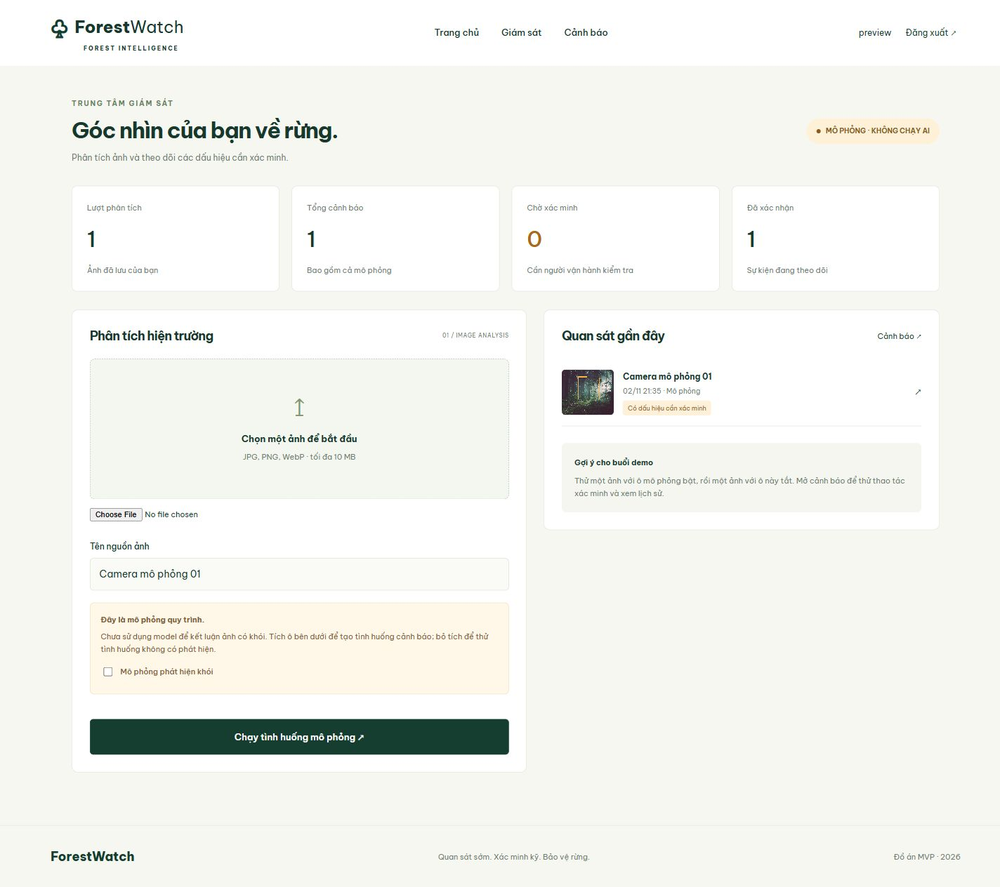

# Kiểm tra bản MVP

Đã chạy trên Python 3.12, Django 5.2 và TypeScript 5.9:

- `python manage.py check`: không có lỗi.
- `python manage.py makemigrations --check --dry-run`: migration khớp models.
- `python manage.py test monitor`: 9 tests đạt.
- `npm run build`: biên dịch thành công.
- Trình duyệt: trang chủ, đăng nhập, tải ảnh, preview ảnh, tạo cảnh báo mô phỏng, xác nhận và xuất hiện lịch sử; quan sát giao diện hẹp và desktop.

Ảnh chụp dashboard dùng tài khoản `preview` và sự kiện mô phỏng phục vụ kiểm tra; tài khoản, mật khẩu và database này không nằm trong ZIP/Git. Tạo tài khoản riêng theo README.

Chưa xác minh model khói thật, GPU hoặc độ chính xác AI vì chưa có trọng số đã huấn luyện. Test adapter YOLO dùng kết quả giả lập để kiểm tra giao tiếp, không phải benchmark model.

